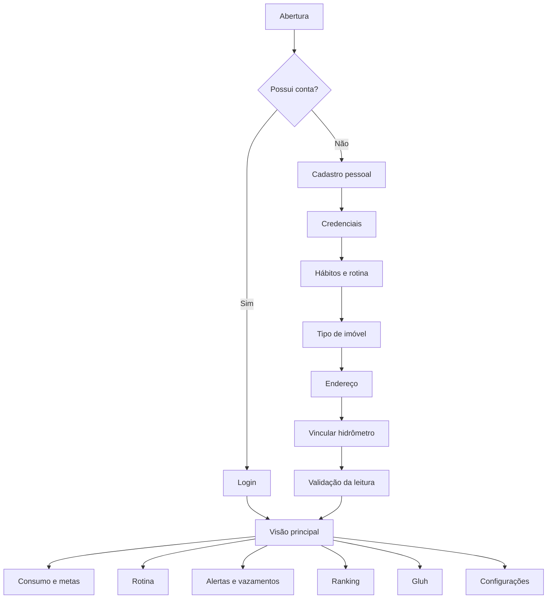
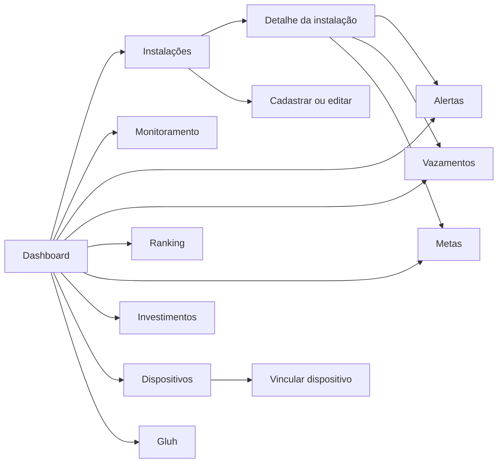

# Fluxos e funcionalidades da experiência Delta

## Objetivo

Este documento registra os fluxos de uso e as funcionalidades representadas no protótipo do Delta no Figma. Ele serve como referência para produto, UX, desenvolvimento e testes, sem substituir requisitos funcionais, regras de negócio ou documentação de implementação.

## Escopo e fontes

A análise foi realizada em 22 de outubro de 2026 a partir das seguintes fontes:

- [arquivo DELTA no Figma](https://www.figma.com/design/rEBSjuVEKxAZD6e4HwEDNW/DELTA%F0%9F%92%A7?node-id=6-3823);
- [requisitos funcionais](../EQS/requisitos-funcionais.md);
- [arquitetura de dados](../DADOS/infra-bancos.md);
- [modelagem MongoDB](../DADOS/NoSQL/modelagem-mongodb.md);
- [pesquisa de cenários de investimento](../DADOS/SQL/pesquisa-cenarios-investimento.md).

Foram inspecionadas as páginas `protótipo mobile`, `protótipo plataforma` e `searchs UX - UI kit / Camiseta`, com atenção especial às seções V2 e às telas que representam estados de sucesso, erro, vazio, alerta e detalhamento.

> **Importante:** o Figma demonstra intenção de experiência e comportamento esperado. Uma tela desenhada não comprova que a funcionalidade já foi implementada. Valores, datas, nomes, endereços, percentuais e alertas exibidos nas pranchetas são exemplos de interface, salvo quando outra documentação os define como regra.

## Convenções de leitura

| Termo | Significado neste documento |
| --- | --- |
| **Previsto no protótipo** | Existe uma tela, componente ou estado visual no Figma. |
| **Documentado** | Há requisito ou regra correspondente no handbook. |
| **Pendente de validação** | O Figma sugere o comportamento, mas falta decisão explícita ou evidência de implementação. |
| **V1 / V2** | Alternativas ou evoluções de interface mantidas no mesmo arquivo. V2 é tratada como referência principal quando não há indicação contrária. |

## Visão geral da experiência

O protótipo apresenta duas superfícies complementares:

| Superfície | Público sugerido pelo protótipo | Uso principal |
| --- | --- | --- |
| Aplicativo mobile | Morador ou responsável por uma residência | Acompanhar consumo, cadastrar rotina, receber alertas, analisar possíveis vazamentos, conversar com o Gluh e gerenciar perfil, residência, unidades e sensores. |
| Plataforma web | Gestor de várias instalações comerciais ou industriais | Comparar unidades, monitorar consumo e vazão, administrar instalações e dispositivos, acompanhar alertas, metas, vazamentos, ranking e cenários de investimento. |

A separação de públicos é uma leitura da interface. O handbook ainda precisa definir formalmente os papéis, permissões e diferenças de acesso entre pessoa residente, gestor e organização.

## Mapa dos fluxos principais

Na plataforma web, a visão principal se desdobra em gestão de várias instalações:

## Aplicativo mobile

### 1. Abertura e autenticação

O início da experiência contém estados de carregamento, apresentação da marca, entrada para login e entrada para cadastro.

#### Login

Elementos previstos:

- identificação por usuário ou e-mail;
- senha;
- alternativa de acesso por Facebook, Apple ou Google;
- estado de carregamento antes de abrir a área autenticada.

O uso de provedores sociais aparece somente como opção visual. Provedores, regras de autenticação e recuperação de senha precisam ser confirmados nos repositórios de implementação.

#### Cadastro progressivo

O formulário mostra cinco segmentos de progresso, com ação de voltar. Depois dessas etapas, o protótipo apresenta o vínculo do hidrômetro como conclusão do onboarding:

1. **Dados pessoais:** nome completo, data de nascimento e telefone.
2. **Credenciais:** e-mail, senha e confirmação da senha.
3. **Hábitos da rotina:** seleção de atividades como banho longo, lavar quintal, lavar roupa, regar plantas, lavar carro e lavar louça.
4. **Características do imóvel:** classificação, como residencial ou comercial, e tipo do imóvel, como casa ou apartamento.
5. **Localização:** CEP, estado e cidade, com indicação de preenchimento automático a partir do CEP.

Após o preenchimento, o usuário passa pelo **vínculo do hidrômetro**, com leitura de QR Code, alternativa para inserir o código manualmente e confirmação de leitura verificada.

O fluxo de QR Code informa que os dados do hidrômetro são usados para personalizar a experiência. Permissões de câmera, formato do código, tratamento de código inválido e possibilidade de pular o vínculo não estão definidos no protótipo.

### 2. Dashboard mobile

O dashboard é uma visão resumida de uma unidade selecionada. A prancheta V2 mostra:

- unidade atual no cabeçalho;
- acesso a notificações e configurações;
- consumo atual em litros;
- comparação com o período anterior;
- custo previsto;
- percentual de cumprimento da meta mensal;
- evolução histórica em gráfico;
- lista de alertas recentes;
- resumo de vazamento identificado;
- ação para abrir o diagnóstico completo.

O resumo de vazamento apresenta exemplos de volume perdido, impacto financeiro e duração. Esses valores devem ser tratados como estimativas e sempre associados a período e unidade.

### 3. Rotina hídrica

A área de rotina permite planejar atividades que consomem água e comparar a agenda com uma meta diária.

#### Estados previstos

- **Agenda vazia:** calendário e ação `Adicionar hábito`.
- **Agenda preenchida:** atividades organizadas por horário, categoria, duração e consumo estimado.
- **Conflito de consumo:** aviso quando atividades simultâneas ultrapassam a vazão considerada segura para a residência.
- **Detalhe do hábito:** informações completas, consumo estimado e ações de edição ou exclusão.

#### Dados de um hábito

- nome e categoria;
- dia agendado;
- horário de início e fim;
- duração média;
- recorrência;
- estimativa de consumo em litros;
- participação estimada na meta da residência.

#### Tratamento de conflito

Quando duas atividades se sobrepõem, o protótipo calcula a vazão combinada e oferece:

- `Ajustar automático`, para redistribuir os horários;
- `Ignorar`, para manter a programação;
- consulta ao `Gluh Helper` a partir do detalhe do hábito.

O algoritmo de ajuste, o limite seguro de vazão e as regras para recalcular a agenda são pendentes de definição.

### 4. Alertas, vazamentos e anomalias

O mobile apresenta três níveis de análise relacionados:

1. **Detecção de vazamento:** compara fluxo médio e fluxo atual, destaca consumo contínuo em horários sensíveis e sugere ações.
2. **Análise por horário:** mostra mapa de calor diário, picos por período e consumo simultâneo de equipamentos ou atividades.
3. **Consumo anormal:** compara consumo detectado com a média histórica, informa variação, nível da anomalia e causa quando conhecida.

#### Ações recomendadas no diagnóstico

- verificar o registro geral;
- inspecionar tubulações;
- silenciar ou desativar alertas;
- abrir análise por horário;
- abrir análise de consumo anormal.

#### Informações apresentadas

- vazão em litros por minuto;
- duração do fluxo;
- volume ou custo estimado do desperdício;
- confiança da detecção;
- linha do tempo dos últimos dias;
- comparação semanal, mensal ou anual;
- dias e condições associados aos maiores consumos.

No protótipo, a causa pode aparecer como `Desconhecida`. O sistema não deve apresentar uma causa como confirmada quando houver apenas indício estatístico.

### 5. Gluh, o chatbot

O Gluh funciona como ponto de consulta em linguagem natural sobre os dados da unidade.

#### Entrada da conversa

O usuário pode escrever uma pergunta ou selecionar sugestões, como:

- onde investir para economizar mais;
- se existe vazamento crítico;
- qual unidade teve maior consumo;
- se a meta será ultrapassada;
- como criar uma rotina mais eficiente.

#### Estados previstos

- tela inicial com sugestões;
- conversa em andamento;
- histórico de conversas;
- criação de nova conversa;
- resposta com sugestão de ação;
- coleta de feedback;
- confirmação de agradecimento pelo feedback.

O protótipo não define tempo de retenção do histórico, exclusão de conversa, fontes das respostas ou mensagens de erro. A arquitetura de IA documenta histórico, memória, RAG, agente juiz e guardrails como partes do fluxo, mas isso não comprova que todas estejam implementadas.

### 6. Ranking e unidades

A experiência mobile reúne comparação entre unidades e inclusão de uma nova unidade.

Funcionalidades representadas:

- visão do ranking por mês;
- destaque da unidade mais eficiente;
- filtros por consumo total, economia e evolução;
- lista ordenada de unidades;
- comparação com o período anterior;
- ação `Adicionar unidade`.

O critério exato de posição precisa ser consistente em todas as superfícies. A arquitetura menciona ranking por menor consumo mensal, mas o protótipo também exibe economia e evolução.

### 7. Configurações

A tela principal de configurações oferece acesso a:

- informações pessoais;
- informações residenciais;
- unidades;
- sensores cadastrados;
- desempenho do usuário.

Em informações pessoais, o protótipo permite visualizar ou alterar nome, e-mail, senha e telefone. Existem pranchetas específicas para atualização de e-mail, telefone e senha.

As configurações residenciais e de unidades devem reaproveitar os dados coletados no cadastro, evitando solicitações duplicadas e deixando claro qual unidade será modificada.

## Plataforma web

### 1. Acesso e cadastro

O protótipo contém fluxos distintos para login, cadastro de gestor e cadastro de indústria, além de estados de carregamento.

O fluxo sugere que uma organização pode ter um responsável e várias instalações. Entretanto, ainda não há definição no handbook sobre:

- papéis e permissões;
- relação entre gestor, indústria e instalação;
- convite de outros usuários;
- aprovação ou verificação cadastral;
- recuperação de acesso.

### 2. Navegação principal

O menu lateral da versão V2 contém:

- Dashboard;
- Instalações;
- Monitoramento;
- Alertas;
- Vazamentos;
- Ranking;
- Metas;
- Investimentos;
- Dispositivos;
- Gluh;
- Configurações.

O rodapé do menu identifica a pessoa autenticada. O conteúdo deve sempre preservar o contexto da organização e da instalação selecionada.

### 3. Dashboard gerencial

O dashboard apresenta uma visão geral mensal com:

- consumo mensal;
- custo estimado;
- percentual da meta geral;
- evolução histórica dos últimos seis meses;
- ranking rápido de unidades;
- alertas ativos;
- previsão financeira;
- clima atual e probabilidade de chuva.

Os alertas resumidos incluem exemplos de possível vazamento e consumo elevado. Os cartões levam às áreas especializadas correspondentes.

### 4. Instalações

#### Lista e mapa

A tela de instalações oferece:

- busca por nome ou região;
- ordenação por consumo ou consumo por área;
- mapa com marcadores de estado `Normal`, `Atenção` e `Crítico`;
- tabela com consumo mensal, progresso da meta, status e ação `Ver tudo`;
- exportação para PDF;
- ação `Cadastrar instalação`.

#### Cadastro de instalação

O formulário é dividido em três blocos:

| Bloco | Campos representados |
| --- | --- |
| Dados gerais | Nome da unidade, tipo de imóvel, CEP, cidade e estado. |
| Consumo | Consumo mensal em m³ e meta mensal. O consumo pode ficar em branco quando ainda não existe histórico de leituras. |
| Vincular dispositivo | ID do hidrômetro ou dispositivo. |

Existem estados separados para cadastro válido e cadastro com erro. O protótipo também apresenta ações `Cancelar` e `Salvar instalação`.

#### Edição

Há telas de edição com estado normal e estado de erro. A edição deve carregar os valores atuais, informar campos inválidos e preservar os dados quando houver falha de validação.

#### Detalhe da instalação

O detalhe de uma unidade apresenta:

- consumo atual;
- vazão média;
- custo previsto;
- percentual da meta;
- exportação em PDF;
- edição da instalação;
- gráfico de evolução histórica;
- limite diário e volume restante na meta.

O conteúdo é dividido em abas:

- Consumo;
- Vazão;
- Alertas e vazamentos;
- Previsão e clima;
- Histórico.

### 5. Monitoramento

A tela de monitoramento representa acompanhamento em tempo semi-real.

#### Controles

- intervalos de 5, 10 ou 15 minutos;
- exportação para PDF.

#### Indicadores

- consumo do dia;
- vazão média;
- quantidade de leituras recentes;
- quantidade de instalações online;
- evolução temporal agregada;
- tabela de status por instalação.

A tabela combina consumo mensal, vazão atual e estado `Normal`, `Atenção` ou `Crítico`.

### 6. Central de alertas

A central possui filtros `Todos`, `Crítico`, `Atenção` e `Informativo`, além do total de alertas ativos.

Tipos representados:

- possível vazamento;
- limite ultrapassado;
- consumo acima do esperado;
- mudança anormal de padrão;
- previsão de ultrapassagem da meta;
- tarifa atualizada;
- previsão da conta disponível.

Cada item mostra contexto, instalação, momento e severidade. O ícone de fechamento sugere dispensar o item, mas o efeito precisa ser definido: ocultar, reconhecer ou resolver são ações diferentes.

### 7. Vazamentos

A área de vazamentos reúne:

- quantidade de vazamentos ativos;
- quantidade em investigação;
- impacto financeiro estimado no mês;
- diagnóstico por instalação;
- gráfico do fluxo no período crítico;
- ações recomendadas;
- histórico de ocorrências.

Cada ocorrência pode conter vazão, duração, volume ou impacto estimado, confiança e status. O histórico diferencia casos resolvidos de casos ativos.

### 8. Metas

A visão de metas apresenta:

- cumprimento médio;
- quantidade de unidades dentro da meta;
- quantidade de unidades críticas;
- potencial anual de economia;
- cartão por unidade com percentual, limite estabelecido, consumo e estado;
- ação `Ajustar meta`;
- exportação para PDF.

O requisito funcional permite metas em litros, m³ ou reais. A interface deve sempre mostrar a unidade de medida e explicar o período da meta.

### 9. Ranking

O ranking apresenta:

- período de referência;
- unidade mais eficiente;
- consumo total;
- economia estimada;
- comparação visual entre unidades;
- classificação completa;
- variação em relação ao período anterior;
- exportação para PDF.

Antes da implementação, deve ser definido se o ranking usa consumo absoluto, consumo por área, percentual da meta, economia ou uma pontuação composta.

### 10. Dispositivos

A gestão de dispositivos contém:

- busca por ID ou instalação;
- ação `Vincular dispositivo`;
- resumo de dispositivos pareados;
- resumo de dispositivos online;
- aviso de bateria baixa;
- quantidade de unidades sem dispositivo;
- tabela com ID, instalação, conectividade e bateria;
- lista de instalações sem dispositivo vinculado.

O fluxo de vínculo solicita o ID do hidrômetro e permite associá-lo a uma instalação. Estados de ID inexistente, dispositivo já vinculado, dispositivo offline e falha de comunicação não aparecem e precisam ser especificados.

### 11. Simulador de investimentos

A tela compara cenários como:

- torneiras ou registros economizadores;
- reúso de água;
- captação de água da chuva;
- situação atual sem investimento adicional.

Cada opção exibe investimento, redução estimada e prazo de retorno. A área de impactos projetados está incompleta no protótipo.

Os números visuais do Figma não coincidem integralmente com a pesquisa registrada no handbook. Para produto, os valores devem vir da fonte de dados aprovada e ser apresentados como **estimativas de referência**, nunca como cotação ou retorno garantido.

### 12. Gluh na plataforma web

O Gluh oferece:

- perguntas sugeridas sobre investimento, vazamentos, consumo e metas;
- campo de mensagem;
- conversa em andamento;
- histórico de conversas;
- ação para iniciar nova conversa.

As respostas devem deixar explícito quando um valor é estimado, qual unidade foi consultada e qual período foi considerado.

## Estados transversais necessários

As duas superfícies devem prever, mesmo quando ainda não desenhados:

- carregamento inicial e atualização parcial;
- ausência de dados ou de histórico;
- erro de validação;
- erro de rede ou serviço indisponível;
- dispositivo offline ou sem leituras recentes;
- permissão negada para câmera no vínculo por QR Code;
- confirmação após salvar, editar ou vincular;
- diferenciação entre dado real, estimativa e recomendação;
- unidade de medida e período em todos os indicadores;
- contexto da residência, organização ou instalação selecionada.

## Rastreabilidade com os requisitos funcionais

| Requisito | Evidência no protótipo |
| --- | --- |
| Cadastro da rotina | Seleção inicial de hábitos, agenda de rotina, detalhe, edição e conflito de vazão. |
| Limites e metas | Meta mensal, meta diária, progresso por unidade e ação de ajuste. |
| Monitoramento em tempo semi-real | Intervalos de 5, 10 e 15 minutos, consumo, vazão, leituras recentes e gráfico temporal. |
| Conversão para valor monetário | Custo previsto, impacto estimado do vazamento e economia projetada. |
| Alertas inteligentes | Central por severidade, alertas no dashboard e previsão de ultrapassagem. |
| Detecção de vazamentos | Diagnóstico, confiança, análise horária, histórico e ações recomendadas. |
| Previsão da conta | Cartão de previsão financeira e alerta de previsão disponível. |
| API de clima | Clima atual, chance de chuva e aba de previsão e clima. |
| Chatbot inteligente | Gluh com sugestões, conversa e histórico. |
| Dashboard gerencial | Indicadores consolidados, gráficos, ranking, alertas e previsão financeira. |

## Divergências e pendências encontradas

### Organização do arquivo

- V1 e V2 permanecem juntas e contêm telas duplicadas com nomes repetidos.
- Há nomes de camada provisórios ou com erro de digitação, como `chatbot-susgestao001`, `confioguração-conta`, `atualizaçao-*` e grupos sem significado funcional.
- Algumas telas atuais usam identidade visual diferente da seção detalhada de rotina.
- Há uma anotação no arquivo informando dificuldade de produzir alguns gráficos; ela não constitui requisito funcional.

### Produto e regras

- Papéis de residente, gestor e indústria não estão formalizados.
- O critério do ranking varia entre consumo, economia, evolução e consumo por área.
- As ações de fechar alerta, ignorar conflito e desativar alertas não têm consequência documentada.
- Exportação para PDF aparece em várias telas, mas não consta nos requisitos funcionais atuais.
- Login social aparece no mobile, mas não há evidência documental de integração.
- O simulador de investimentos usa valores diferentes dos cenários documentados e contém uma área ainda vazia.
- A leitura por QR Code não define permissão de câmera, validação, expiração ou recuperação de erro.
- Textos e exemplos misturam contexto residencial com comercial ou industrial.

### Consistência de dados

- Alguns cartões exibem litros, outros m³, L/min, L/h ou reais sem uma regra comum de conversão.
- Metas precisam declarar período e unidade de medida em todas as telas.
- Comparações devem informar a base, como `ontem`, `mês anterior` ou `média das últimas quatro semanas`.
- Previsões, confiança e impacto financeiro devem ser identificados como estimativas.

## Critérios funcionais recomendados para validação

1. O usuário sempre sabe qual unidade ou instalação está consultando.
2. Todo indicador informa unidade de medida e período.
3. Uma instalação sem histórico mostra estado vazio e não valores fictícios.
4. Um alerta pode ser diferenciado entre novo, reconhecido, em investigação e resolvido.
5. Um possível vazamento não é apresentado como causa confirmada sem evidência suficiente.
6. O cadastro preserva os dados já preenchidos ao voltar ou ao ocorrer erro.
7. O vínculo de dispositivo informa sucesso, falha, duplicidade e dispositivo indisponível.
8. A rotina explica por que existe conflito e o que o ajuste automático mudará.
9. O Gluh informa contexto, período e caráter estimado de previsões.
10. A versão implementada é validada contra a V2 aprovada, não contra pranchetas antigas ou grupos auxiliares.

## Histórico de atualização

| Data | Alteração |
| --- | --- |
| 2026-10-22 | Primeira documentação completa dos fluxos e funcionalidades presentes no Figma, com comparação aos requisitos e registro de pendências. |
